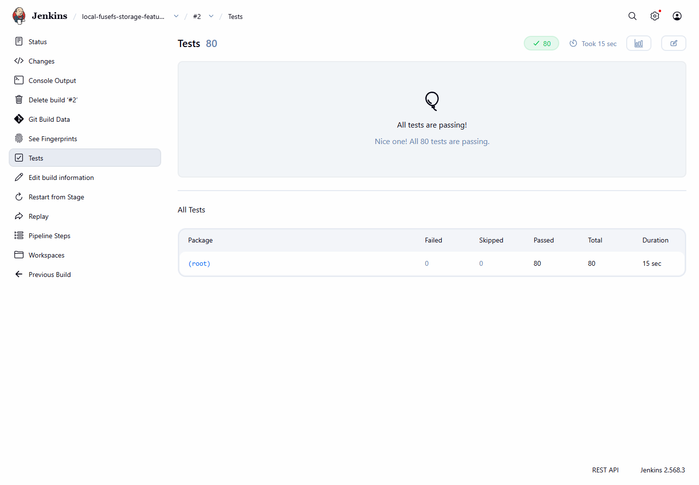

# Local FUSE filesystem and CI/CD

`local-fusefs` 0.2 is a persistent Linux FUSE 3 filesystem with encrypted,
compressed, content-addressed storage. The feature branch is
`codex/fusefs-storage-features`.

This repository includes the filesystem source (`src/`), tests and benchmarks,
the Jenkins pipeline (`Jenkinsfile`, `ci/`), and the scripts that configure local
Gitea and Jenkins (`scripts/`). Generated service configurations, credentials,
filesystem stores, downloaded tools, and compiled packages stay outside Git.

## Run in WSL2 Ubuntu 24.04

From this Windows workspace, install the added libraries once:

```powershell
./scripts/Install-LinuxPrerequisites.ps1
```

Then in Ubuntu:

```bash
cd /mnt/c/path/to/your/fuse-filesystem
bash ci/build.sh
mkdir -p "$HOME/mnt/local-fusefs"
./build/fusefs-admin init "$HOME/fusefs-store" --key-file "$HOME/fusefs.key" \
  --chunk-size 65536 --compression 3
./build/local-fusefs --store "$HOME/fusefs-store" --key-file "$HOME/fusefs.key" \
  --cache-mib 64 "$HOME/mnt/local-fusefs"
```

The mount runs in the foreground with up to 16 FUSE workers. In another Ubuntu
terminal, create and use files normally:

```bash
printf 'Hello from persistent FUSE!\n' > "$HOME/mnt/local-fusefs/hello.txt"
cat "$HOME/mnt/local-fusefs/hello.txt"
fusermount3 -u "$HOME/mnt/local-fusefs"
```

Keep the store on WSL's native Linux filesystem, not `/mnt/c`. Initialization
creates an empty filesystem and a random 32-byte key if the key does not exist.
The store is mode 0700; the key is mode 0600 and must remain outside the store.
The earlier read-only `hello.txt` demo had no persistent data to migrate.

## Features

| Feature | Implementation |
| --- | --- |
| Thread safety | Multiple FUSE workers; serialized storage transactions and cache access |
| Crash-safe writes | SQLite WAL, FULL synchronization, atomic metadata/chunk commits |
| Atomic rename | Replace, `RENAME_NOREPLACE`, and `RENAME_EXCHANGE` |
| Streaming I/O | Offset-based, bounded chunk buffers; no whole-file materialization |
| File locking | Kernel POSIX byte-range, OFD, and BSD advisory locks |
| Permissions | Unix uid/gid/mode, umask, kernel enforcement, chmod/chown |
| Symlinks | Relative, absolute, and dangling links |
| Sparse files | Implicit zero chunks, truncate, hole punching, SEEK_DATA/SEEK_HOLE |
| Configurable chunks | 4 KiB–4 MiB powers of two, fixed per store |
| Compression | Zstandard levels 1–19; 0 disables; incompressible chunks stored raw |
| Authenticated encryption | AES-256-GCM with random nonce; HMAC-authenticated version maps |
| Content-addressed storage | SHA-256 chunk addresses |
| Deduplication | Identical chunks share encrypted storage within one store |
| Version history | Contents and size after each write/truncate/punch/restore |
| Garbage collection | Preserve live/history references; prune explicitly; compact database |
| Local cache | Bounded in-memory LRU of authenticated chunks; configurable or disabled |
| Corruption detection | Authentication tags, hashes, version-map authentication, SQLite checks |
| Integrity checker | Offline `fsck`; nonzero exit on inconsistency; GC refuses corrupt stores |
| Administration CLI | Init, stats, fsck, history, restore, cat, put, prune, gc |
| Automated tests | 17 storage test groups and 23 real mounted FUSE cases; sanitizer runs |
| Benchmarks | Three chunk-size workloads plus actual kernel/FUSE throughput; JSON output |

See [storage guarantees and limits](docs/storage.md) for the precise durability,
encryption, locking, versioning, and cache behavior. Atomicity is per FUSE request;
a large application write can contain multiple requests. For whole-file atomic
updates, write a temporary file, fsync it, and rename it. Filesystem namespace and
Unix ownership metadata are visible at rest.

## Administration

Unmount first; the CLI and mounts share an exclusive store lock. For example:

```bash
ADMIN=./build/fusefs-admin
STORE="$HOME/fusefs-store"
KEY="$HOME/fusefs.key"
"$ADMIN" stats "$STORE" --key-file "$KEY"
"$ADMIN" fsck "$STORE" --key-file "$KEY"
"$ADMIN" history "$STORE" --key-file "$KEY" --path /hello.txt
# Choose a version ID from history:
"$ADMIN" cat "$STORE" --key-file "$KEY" --path /hello.txt --version 2
"$ADMIN" restore "$STORE" --key-file "$KEY" --path /hello.txt --version 2
"$ADMIN" prune "$STORE" --key-file "$KEY" --keep 10
"$ADMIN" gc "$STORE" --key-file "$KEY"
```

`prune` permanently removes older history. `gc --purge-deleted` also permanently
removes unlinked inodes and their history; plain `gc` retains them. `fsck` checks
and reports errors without repairing data. Keep unmounted store backups and the
key separately. Losing the key makes content unrecoverable.

## Tests and benchmarks

### Verified Jenkins run

On October 20, 2026, Jenkins build **#2** of `local-fusefs-storage-features`
completed successfully against source commit
`ac9b99d6643a5b8531329245c42599311981a370` in WSL2 Ubuntu 24.04:

- **80 passed, 0 failed, 0 skipped:** 40 storage/mounted FUSE cases, repeated
  under AddressSanitizer and UndefinedBehaviorSanitizer.
- All four benchmark workloads and the package validation stage passed.
- The screenshot below was captured directly from that build's Jenkins test
  report. Subsequent publication changes only add documentation and ignore rules.



The [live report](http://127.0.0.1:8080/job/local-fusefs-storage-features/2/testReport/)
is available on the machine hosting Jenkins after signing in. The screenshot
above can be viewed without access to that local service.

### Run the checks

All tests require Linux, `/dev/fuse`, and a non-root test user. Missing FUSE is a
failure, not a skipped test. Fixtures use private disposable Linux directories.

```bash
bash ci/build.sh configure
bash ci/build.sh test
bash ci/sanitize.sh
bash ci/build.sh benchmark
bash ci/build.sh package
```

Tests cover a randomized reference model, cross-chunk I/O, concurrent writes and
append, a 1 TiB sparse file, offset overflow, encryption tampering, missing and
substituted chunks/maps, wrong keys, permissions, blocking locks, symlinks,
renames, open/unlink lifetime, remounts, version restoration, pruning and GC.
Deterministic SIGKILL tests exercise transactions before and after commit,
including recovery during maintenance. A mounted crash test verifies that
acknowledged/fsynced content survives daemon death. AddressSanitizer and
UndefinedBehaviorSanitizer run the same cases again. Packaging extracts and
mount-tests the Debian package's binaries.

CMake keeps compiler output in `~/.cache/local-fusefs`; test reports and binaries
are copied to `build/`, and packages/checksums/benchmark JSON to `artifacts/`.
The benchmark methodology is described in [docs/benchmarks.md](docs/benchmarks.md).

## Jenkins and local Git

| Service | Address |
| --- | --- |
| Private Git repository | http://127.0.0.1:3000/chris/local-fusefs |
| Main pipeline | http://127.0.0.1:8080/job/local-fusefs/ |
| Feature pipeline | http://127.0.0.1:8080/job/local-fusefs-storage-features/ |

Jenkins runs on Windows and launches each build/test/benchmark stage through
`wsl.exe -d Ubuntu-24.04 -u chris`. Compilation and all tests execute in Linux,
including actual FUSE mounts. The feature job checks out this branch from Gitea,
polls every minute, and publishes JUnit reports, benchmark JSON, `.deb` and
`.tar.gz` packages. The deployment stage runs only for `origin/main`; feature
builds leave the main staging installation in place.

Create/update the feature job after pushing the branch:

```powershell
./scripts/New-BranchJob.ps1
```

Both services bind to localhost and require sign-in. Username: `chris`; generated
service passwords are in `.runtime/access.json`, protected by Windows ACLs and
excluded from Git. Gitea data is in `.runtime/gitea`; Jenkins data is in
`.runtime/jenkins`. Jobs run trusted local code under your Windows/WSL account.

In PowerShell 7, from the workspace:

```powershell
./scripts/Start-Services.ps1
./scripts/Get-Status.ps1
# Edit, commit, and push to the feature branch:
git add src tests
git commit -m "Describe the change"
git push
```

Stop idle servers with `./scripts/Stop-Services.ps1`. They are background user
processes: run `Start-Services.ps1` again after Windows restarts. Logs are under
`.runtime/logs`. Stop both services before backing up `.runtime`; it contains
credentials and build history.

To recreate the service setup, install Git for Windows, PowerShell 7, and WSL2
Ubuntu 24.04 with Linux user `chris`, then run `Download-Tools.ps1`,
`Install-LinuxPrerequisites.ps1`, `Install-JenkinsPlugins.ps1`,
`Initialize-Services.ps1`, and `Start-Services.ps1` from `scripts/`. After both
servers are ready, `Initialize-Repository.ps1` creates the local private repo and
pushes an existing committed `main` branch. Downloads use official sites with
SHA-256 verification; `.runtime/versions.json` records installed core versions.

Upstream references: [libfuse API](https://libfuse.github.io/doxygen/structfuse__lowlevel__ops.html),
[SQLite WAL](https://www.sqlite.org/wal.html),
[OpenSSL authenticated encryption](https://docs.openssl.org/3.0/man3/EVP_EncryptInit/).
